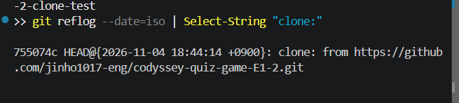
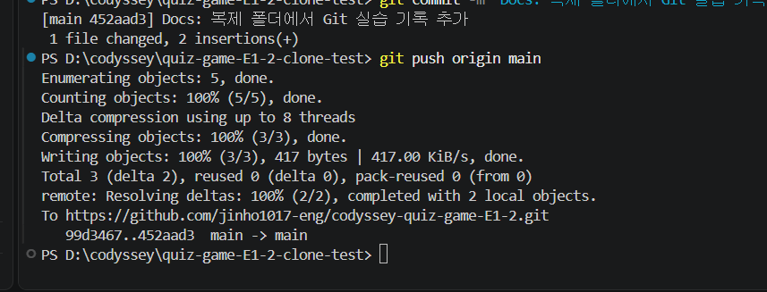
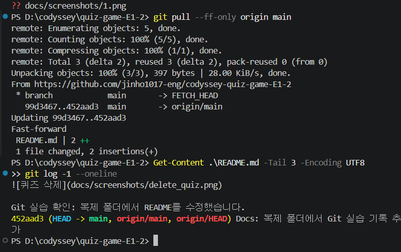
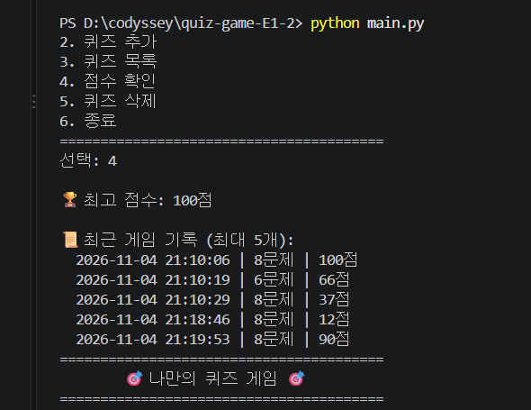
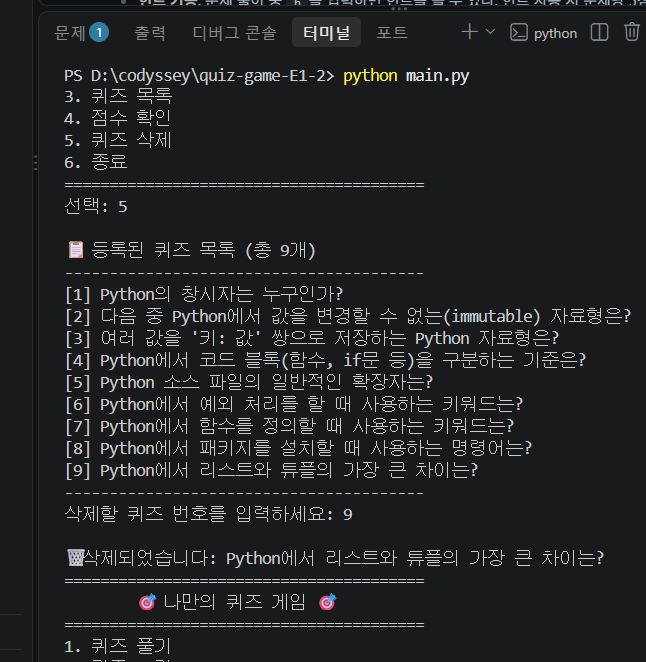

# Codyssey 파이썬 퀴즈 게임

## 1. 프로젝트 개요

터미널에서 실행하는 Python 콘솔 퀴즈 게임이다. 메뉴를 통해 퀴즈 풀기, 퀴즈 추가, 목록 확인, 점수 확인 기능을 제공하며, 모든 데이터는 `state.json` 파일에 저장되어 프로그램을 종료했다가 다시 실행해도 유지된다.

## 2. 퀴즈 주제와 선정 이유

**주제: Python 상식**

과제 자체를 Python으로 구현하면서, Python 언어 자체에 대한 지식(창시자, 자료형, 문법 등)을 퀴즈로 정리하면 복습 효과가 있을 것 같아 이 주제를 선택했다. 프로그램을 만드는 언어와 퀴즈 주제가 자연스럽게 연결되는 점도 좋았다.

## 3. 실행 방법

```bash
python main.py
```

Python 3.10 이상이 설치되어 있어야 한다. 외부 라이브러리는 사용하지 않는다(표준 라이브러리만 사용).

## 4. 기능 목록

- **퀴즈 풀기**: 선택한 문제 수만큼, 등록된 퀴즈 중에서 중복 없이 무작위 순서로 출제하고, 정답/오답을 바로 알려준 뒤 최종 점수를 계산한다.
- **퀴즈 추가**: 문제, 선택지 4개, 정답 번호를 입력받아 새 퀴즈를 등록한다.
- **퀴즈 목록**: 현재까지 등록된 모든 퀴즈의 문제를 번호와 함께 보여준다.
- **점수 확인**: 지금까지의 최고 점수를 보여준다. 퀴즈를 풀 때마다 이전 최고 점수와 비교해 갱신한다.
- **공통 처리**: 숫자가 아닌 입력, 범위를 벗어난 입력, 빈 입력(Enter만 입력)을 모두 감지해 재입력을 안내한다. (단, "풀 문제 수 선택"처럼 빈 입력 자체가 기본값으로 허용된 곳은 예외이며, §4-1에 별도로 명시했다.) `Ctrl+C`로 중단하거나 입력 스트림이 끊겨도 비정상 종료 없이 안전하게 저장 후 종료한다.

## 4-1. 보너스 기능

- **랜덤 출제**: 퀴즈를 풀 때마다 문제 순서가 매번 랜덤으로 섞인다.
- **문제 수 선택**: 전체 문제 중 몇 문제를 풀지 직접 선택할 수 있다 (빈 입력 시 전체 문제).
- **힌트 기능**: 문제 풀이 중 `h`를 입력하면 힌트를 볼 수 있다. 힌트 사용 시 문제당 5점이 감점된다. 퀴즈 추가 시에도 힌트를 선택적으로 등록할 수 있다.
- **퀴즈 삭제**: 등록된 퀴즈를 번호로 선택해 삭제할 수 있다.
- **점수 기록 히스토리**: 퀴즈를 풀 때마다 날짜/시간, 문제 수, 점수가 기록되며, 점수 확인 화면에서 최근 5개 기록을 확인할 수 있다.

## 5. 파일 구조

```text
.
├── main.py                # 프로그램 진입점
├── quiz.py                # Quiz 클래스 (퀴즈 1개를 표현)
├── quiz_game.py           # QuizGame 클래스 (게임 전체 관리)
├── default_quizzes.py     # 기본 Python 상식 퀴즈 데이터
├── state.json             # 저장된 퀴즈/점수/기록 데이터 (실행 시 자동 생성, Git에는 포함하지 않음)
├── docs/
│   └── screenshots/       # 제출용 실행 화면 캡처
├── .gitignore
└── README.md
```

## 6. 데이터 파일 설명 (`state.json`)

- **위치**: 프로젝트 루트 (`main.py`와 같은 폴더)
- **역할**: 사용자가 추가한 퀴즈, 최고 점수, 게임 기록을 저장해, 프로그램을 재시작해도 데이터가 유지되도록 한다.
- **저장 시점**: 다음 경우에 자동으로 저장된다.
  - 퀴즈를 추가했을 때
  - 퀴즈를 삭제했을 때
  - 퀴즈 한 판을 완료했을 때 (점수·기록이 바뀌었는지와 무관하게 매번 저장)
  - `Ctrl+C` 또는 입력 스트림 종료(EOF)로 중단되었을 때 (그 시점까지의 상태를 저장 후 종료)
- **최초 실행(파일 없음)**: `state.json`이 아직 없으면 `default_quizzes.py`의 기본 퀴즈 데이터로 시작하고, 최고 점수는 "없음"(`None`), 게임 기록은 빈 리스트 상태다.
- **인코딩**: UTF-8
- **스키마**:

```json
{
    "quizzes": [
        {
            "question": "문제 내용",
            "choices": ["선택지1", "선택지2", "선택지3", "선택지4"],
            "answer": 1,
            "hint": "힌트가 있는 경우의 예시 텍스트"
        },
        {
            "question": "힌트 없이 등록된 문제",
            "choices": ["선택지1", "선택지2", "선택지3", "선택지4"],
            "answer": 2,
            "hint": null
        }
    ],
    "best_score": 90,
    "history": [
        {
            "datetime": "2026-11-04 21:10:00",
            "question_count": 8,
            "score": 90
        }
    ]
}
```

- **오류 처리**: JSON 문법 자체가 깨진 경우뿐 아니라, 문법은 맞아도 구조나 값이 잘못된 경우(예: 최상위가 리스트, `quizzes`가 `null`, 선택지가 4개가 아님, 정답이 1~4 범위를 벗어남 등)도 검증해 감지한다. 검증은 데이터 전체를 다 확인한 뒤에만 실제 상태에 반영하므로, 일부만 불러온 채로 남는 경우는 없다. 문제가 발견되면 프로그램이 멈추지 않고 안내 메시지를 출력한 뒤 기본 퀴즈 데이터·초기 점수·빈 기록으로 복구한다. (단, 빈 퀴즈 목록 `"quizzes": []` 자체는 정상적인 상태로 취급한다.)

## 6-1. 점수 계산 규칙

- **기본 점수** = (정답 수 ÷ 출제 수) × 100의 정수 부분
- **최종 점수** = 기본 점수 − (힌트를 사용한 문제 수 × 5)
- **최저 점수**: 0점 (감점으로 음수가 되지 않는다)
- 같은 문제에서 힌트를 여러 번 요청해도, 그 문제에 대한 감점은 1회만 적용된다.
- 힌트는 **해당 문제에 힌트가 등록되어 있을 때만** `h`로 사용할 수 있다. (사용자가 추가한 퀴즈는 힌트를 입력하지 않았다면 `h`가 동작하지 않는다.)

## 7. Git 복제 폴더와 원래 폴더의 변경 반영 실습

이번 실습에서는 기존에 clone해둔 별도 폴더를 사용했다.

1. 복제 폴더 `D:\codyssey\quiz-game-E1-2-clone-test`를 `git pull --ff-only origin main`으로 최신 상태로 갱신했다.
2. 복제 폴더의 README에 실습용 문구를 추가했다.
3. 변경을 커밋하고 GitHub에 push했다.
   - 커밋: `452aad3`
   - 메시지: `Docs: 복제 폴더에서 Git 실습 기록 추가`
4. 원래 폴더 `D:\codyssey\quiz-game-E1-2`에서 `git pull --ff-only origin main`을 실행했다.
5. README의 추가 문구와 `git log -1 --oneline`을 확인해 동일한 커밋 `452aad3`이 반영된 것을 검증했다.

최초 clone 실행 화면 대신, 복제 폴더의 Git reflog에 남아 있는 기록으로 최초 복제 사실을 확인했다. 실습용 문구는 검증 후 커밋 `4fc87f1`에서 삭제했으며, 실습 당시 기록은 커밋 이력과 아래 캡처에 남아 있다.

### 최초 clone 기록 확인

복제 폴더에서 다음 명령으로 최초 clone 기록을 확인했다.

```powershell
git reflog --date=iso | Select-String "clone:"
```

출력에서 `2026-11-04 18:44:14 +0900`에 해당 GitHub 저장소를 clone한 기록을 확인했다.



### 복제 폴더의 commit·push



### 원래 폴더의 pull·반영 확인



## 8. 실행 화면

### 개발 환경


### 커밋 히스토리 (git log --oneline --graph)


### 퀴즈 추가 (힌트 입력 포함)


### 퀴즈 목록


### 퀴즈 풀기 (힌트 사용 포함)


### 점수 확인 + 게임 기록 히스토리



### 퀴즈 삭제


