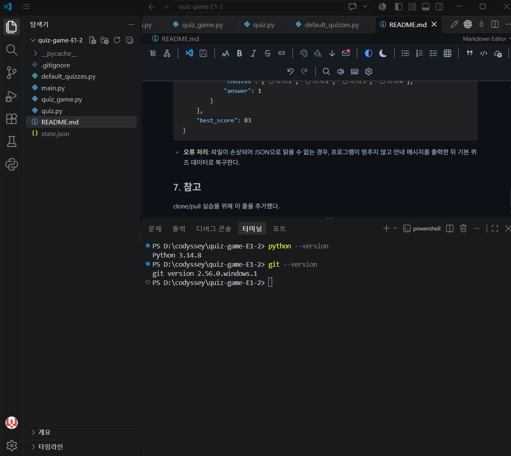
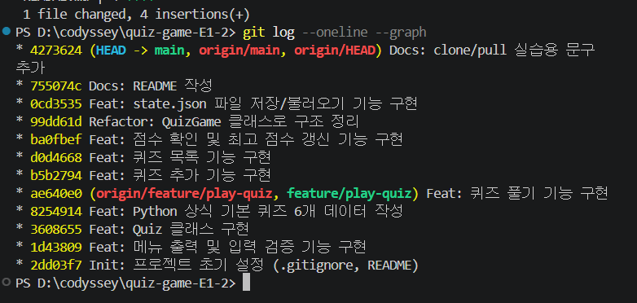
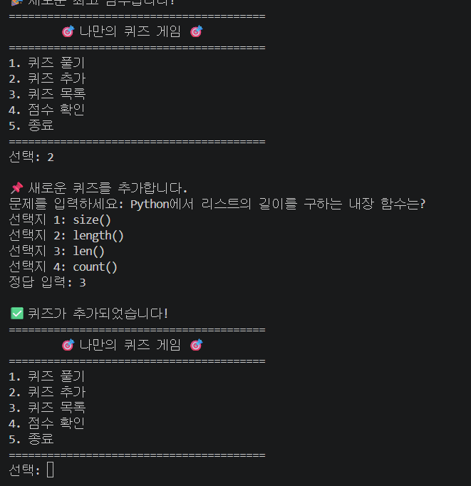
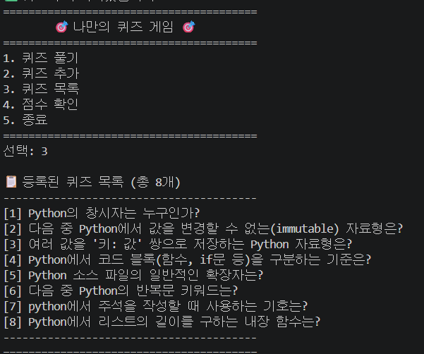
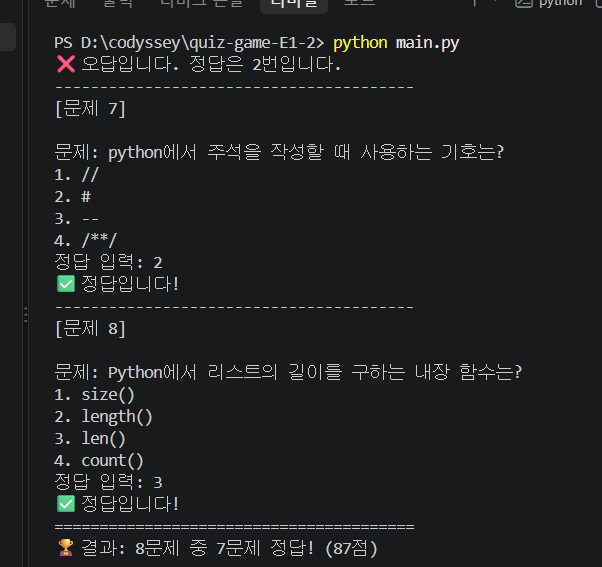
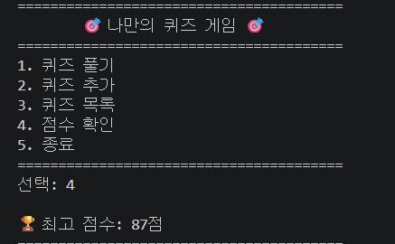

# Codyssey 파이썬 퀴즈 게임

## 1. 프로젝트 개요

터미널에서 실행하는 Python 콘솔 퀴즈 게임이다. 메뉴를 통해 퀴즈 풀기, 퀴즈 추가, 목록 확인, 점수 확인 기능을 제공하며, 모든 데이터는 `state.json` 파일에 저장되어 프로그램을 종료했다가 다시 실행해도 유지된다.

## 2. 퀴즈 주제와 선정 이유

**주제: Python 상식**

과제 자체를 Python으로 구현하면서, Python 언어 자체에 대한 지식(창시자, 자료형, 문법 등)을 퀴즈로 정리하면 복습 효과가 있을 것 같아 이 주제를 선택했다. 프로그램을 만드는 언어와 퀴즈 주제가 자연스럽게 연결되는 점도 좋았다.

## 3. 실행 방법

```bash
python main.py
```

Python 3.10 이상이 설치되어 있어야 한다. 외부 라이브러리는 사용하지 않는다(표준 라이브러리만 사용).

## 4. 기능 목록

- **퀴즈 풀기**: 등록된 모든 퀴즈를 순서대로 출제하고, 정답/오답을 바로 알려준 뒤 최종 점수를 계산한다.
- **퀴즈 추가**: 문제, 선택지 4개, 정답 번호를 입력받아 새 퀴즈를 등록한다.
- **퀴즈 목록**: 현재까지 등록된 모든 퀴즈의 문제를 번호와 함께 보여준다.
- **점수 확인**: 지금까햐지의 최고 점수를 보여준다. 퀴즈를 풀 때마다 이전 최고 점수와 비교해 갱신한다.
- **공통 처리**: 숫자가 아닌 입력, 범위를 벗어난 입력, 빈 입력(Enter만 입력)을 모두 감지해 재입력을 안내한다. `Ctrl+C`로 중단하거나 입력 스트림이 끊겨도 비정상 종료 없이 안전하게 저장 후 종료한다.

## 4-1. 보너스 기능

- **랜덤 출제**: 퀴즈를 풀 때마다 문제 순서가 매번 랜덤으로 섞인다.
- **문제 수 선택**: 전체 문제 중 몇 문제를 풀지 직접 선택할 수 있다 (빈 입력 시 전체 문제).
- **힌트 기능**: 문제 풀이 중 `h`를 입력하면 힌트를 볼 수 있다. 힌트 사용 시 문제당 5점이 감점된다. 퀴즈 추가 시에도 힌트를 선택적으로 등록할 수 있다.
- **퀴즈 삭제**: 등록된 퀴즈를 번호로 선택해 삭제할 수 있다.
- **점수 기록 히스토리**: 퀴즈를 풀 때마다 날짜/시간, 문제 수, 점수가 기록되며, 점수 확인 화면에서 최근 5개 기록을 확인할 수 있다.

## 5. 파일 구조

```text
.
├── main.py             # 프로그램 진입점
├── quiz.py              # Quiz 클래스 (퀴즈 1개를 표현)
├── quiz_game.py          # QuizGame 클래스 (게임 전체 관리)
├── default_quizzes.py    # 기본 Python 상식 퀴즈 데이터
├── state.json            # 저장된 퀴즈/점수 데이터 (실행 시 자동 생성, Git에는 포함하지 않음)
├── docs/
│   └── screenshots/       # 제출용 실행 화면 캡처
├── .gitignore
└── README.md
```

## 6. 데이터 파일 설명 (`state.json`)

- **위치**: 프로젝트 루트 (`main.py`와 같은 폴더)
- **역할**: 사용자가 추가한 퀴즈와 최고 점수를 저장해, 프로그램을 재시작해도 데이터가 유지되도록 한다.
- **생성 시점**: 퀴즈를 추가하거나 최고 점수가 갱신될 때 자동으로 저장된다. 프로그램을 처음 실행할 때는 파일이 없으므로 `default_quizzes.py`의 기본 퀴즈 데이터를 사용한다.
- **인코딩**: UTF-8
- **스키마**:

```json
{
    "quizzes": [
        {
            "question": "문제 내용",
            "choices": ["선택지1", "선택지2", "선택지3", "선택지4"],
            "answer": 1
        }
    ],
    "best_score": 83
}
```

- **오류 처리**: 파일이 손상되어 JSON으로 읽을 수 없는 경우, 프로그램이 멈추지 않고 안내 메시지를 출력한 뒤 기본 퀴즈 데이터로 복구한다.


## 7. 실행 화면

### 개발 환경



### 커밋 히스토리 (git log --oneline --graph)



### 퀴즈 추가



### 퀴즈 목록



### 퀴즈 풀기



### 점수 확인


